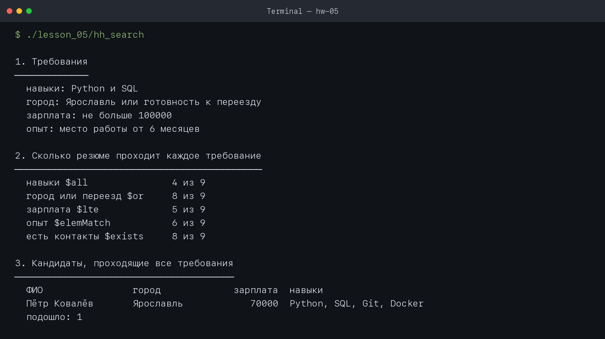
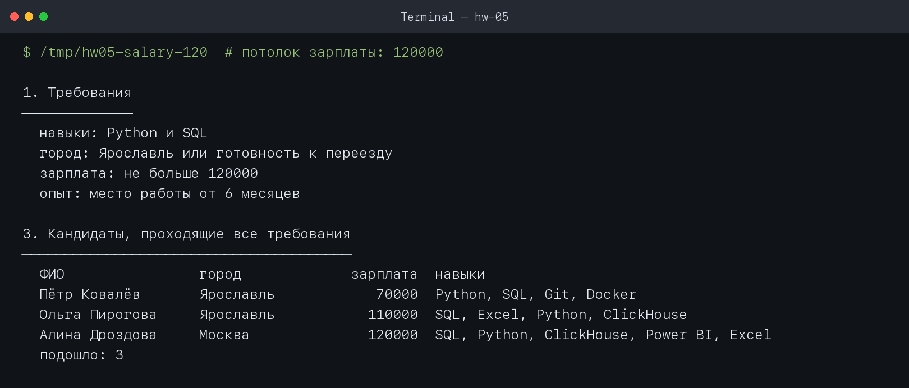
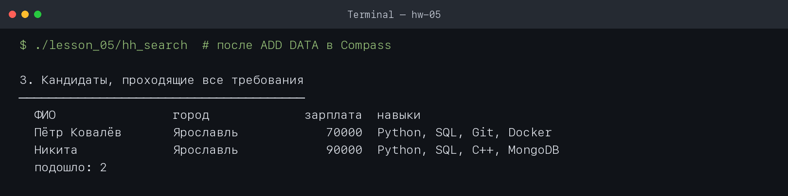

# Домашнее задание № 5 · Скрипт подбора кандидатов

Работа выполнена по [главе 2.9 справочника](https://maximbytecamp.github.io/mongodb_theory_makarov/temy/18-skript-podbor/index.html) на C++17 с локальной MongoDB `mongodb://localhost:27017`.

- **ФИО:** Никита
- **Дата:** 2026-10-08
- **База данных:** `hh`
- **Коллекции:** `resumes`, `vacancies`, `interviews`

## Операторы в разделах отчёта

| Раздел | Операторы и приёмы |
|---|---|
| 1. Требования | Значения четырёх переменных, из которых собираются фильтры |
| 2. Каждое требование отдельно | `$all`, `$or`, `$lte`, `$elemMatch`, `$exists` |
| 3. Все требования сразу | Неявное логическое И условий одного фильтра, `$or`, сортировка по зарплате |
| 4. Должности с Junior | `$regex` и `$options: "i"` |
| 5. Вакансии под ожидание | Точечная нотация `salary.from` / `salary.to`, `$lte`, `$gte` |
| 6. Собеседования за неделю | Полуинтервал дат: `$gte` начала и `$lt` начала следующего дня |
| 7. Проверка данных | `$exists`, `$type`, `$not`, `$size`, `$expr`, `$gt`, `$ne` |
| 8. Кто не прошёл отбор | Чтение документов и проверка причин отказа в C++ |

## Результаты изменения требований

Каждый опыт проводился отдельно: менялась ровно одна переменная, после запуска возвращалось исходное значение.

| Что изменено | Подошло кандидатов | Кто |
|---|---:|---|
| Ничего, исходные требования | 1 | Пётр Ковалёв |
| Навыки: `Python`, `Git` | 2 | Пётр Ковалёв, Марк Ефремов |
| Город: Москва | 0 | — |
| Потолок зарплаты: 120 000 | 3 | Пётр Ковалёв, Ольга Пирогова, Алина Дроздова |
| Срок работы: 3 месяца | 2 | Пётр Ковалёв, Ксения Лапина |
| Добавлено своё резюме «Никита» | 2 | Пётр Ковалёв, Никита |

Учебное резюме «Никита» было добавлено в `hh.resumes` через Compass кнопкой **ADD DATA**. Оно содержит город Ярославль, зарплату 90 000, навыки Python и SQL и место работы длительностью 12 месяцев. После проверки этот документ удалён, база снова содержит исходные 9 резюме.

## Скриншоты

1. Исходный запуск, разделы 1–3: 
2. Потолок зарплаты 120 000, разделы 1 и 3: 
3. Своё резюме найдено в разделе 3: 

## Вывод

Нужно смягчить **потолок зарплаты со 100 000 до 120 000 рублей**. Это минимальное проверенное значение, при котором итоговый список увеличивается с одного до трёх кандидатов: к Петру Ковалёву добавляются Ольга Пирогова с ожиданием 110 000 и Алина Дроздова с ожиданием 120 000. При потолке 110 000 подходят только два кандидата, поэтому этого недостаточно.

В исходном разделе 2 зарплатное условие проходят 5 из 9 резюме; при потолке 120 000 — 7 из 9. Раздел 8 объясняет выбор точнее: у Ольги Пироговой и Алины Дроздовой единственная причина отказа — «зарплата выше потолка». Поэтому изменение только зарплатного требования сразу добавляет двух подходящих кандидатов, не затрагивая навыки, город и опыт. Проверочный запуск показал `подошло: 3`.
